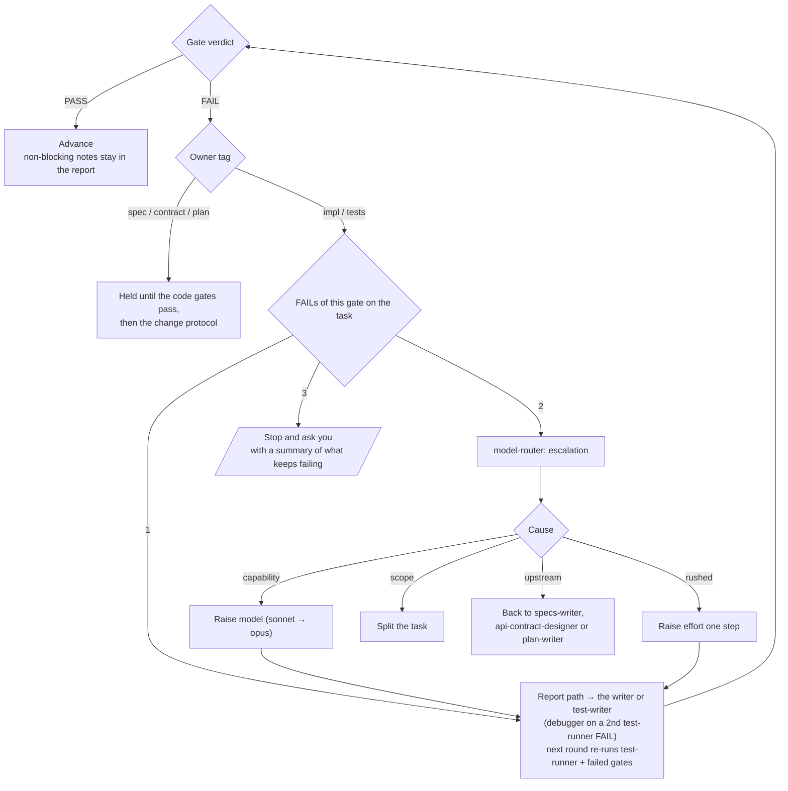

# claude-factory

Spec-driven development for [Claude Code](https://claude.com/claude-code), packaged as two
Claude Code plugins: `factory`, one orchestrator skill (`/factory`) and 30 specialised subagents,
and `factory-mods`, a hooks module that checks and measures their work. Together they take a feature from a rough idea to reviewed, tested and committed code.

Every step writes small Markdown files — one per user story, spec area, interface, decision
and plan task — whose YAML frontmatter holds the data programs read. Each agent loads only the
fragments its step needs, found from two entrypoints and ids that resolve to files by rule, so
context stays small however large the feature grows. Every deliverable passes through a gate
agent that returns `PASS` / `FAIL`, and the orchestrator loops, escalates or asks you instead
of guessing.

- [Install](#install)
- [Usage](#usage)
- [Pipeline](#pipeline)
- [Agents map](#agents-map)
- [Agents](#agents)
- [Files](#files)
- [Data and usage](#data-and-usage)
- [Model routing](#model-routing)
- [Customising](#customising)
- [Developing the plugins](#developing-the-plugins)

## Install

At the prompt of a Claude Code session (2.1.275 or later):

```text
/plugin install factory --marketplace kazax-inc/claude-factory
/plugin install factory-mods --marketplace kazax-inc/claude-factory
```

Answer `y` to add the marketplace, then pick a scope: **user** to use the factory in every
project, **project** to share it with everyone working on the repository. From a shell:

```bash
claude plugin install factory --marketplace kazax-inc/claude-factory
claude plugin install factory-mods --marketplace kazax-inc/claude-factory
```

In the desktop app, where `/plugin` does not run: click **+** next to the prompt box, then
**Plugins**, **Add marketplace** with `kazax-inc/claude-factory`, then **Add plugin** for each of the two.

| Plugin | Brings |
|---|---|
| `factory` | the `/factory` skill and the 30 agents: the pipeline itself |
| `factory-mods` | the hooks: frontmatter checks on every write, usage stats per task, `/factory-check` |

`factory` works on its own; `factory-mods` adds the checks and the stats, and is only useful
with `factory`. Nothing else is needed: no settings to merge, no Python or Node, and the same
install works on Windows, macOS and Linux, because the hooks are a TypeScript module that
Claude Code runs itself.

> `factory` 0.4 writes the v2 file format described below, under `.factory/`. `factory-mods`
> still checks the previous format and the old `.plan/` and `.specs/` folders, so until it is
> updated, install `factory` alone.

The pipeline commits each finished task with git: allow `git add` and `git commit` in your
permission settings, or approve them when asked.

Then run `/factory setup` in the project you want to build: it asks four questions (who can
reach the software, test depth, test levels, pacing) and writes `.factory/settings.json`. If you
skip it, `/factory new` asks the same questions the first time.

## Usage

| Command | What it does |
|---|---|
| `/factory setup [--defaults] [<change in words>]` | Creates `.factory/settings.json`, or checks it and applies a change you describe ("use opus for the implementer"). `--defaults` skips the questions. |
| `/factory new <feature> [idea text \| path/to/brief.md] [--until <target>]` | Creates a new feature from an idea and runs the pipeline up to the target (default `workflow.until`, `plan`). |
| `/factory` or `/factory next [<feature>] [--through \| --until <target>]` | Resumes the active feature (or `<feature>`) at its next step. |
| `/factory status` | Lists every feature with its stage, tasks done and what it is waiting on. Read-only. |
| `/factory switch <feature>` | Makes `<feature>` the active feature. |

`<feature>` is a kebab-case slug. Saying "let's build X" or "spec out Y" without a command is
treated as `/factory new`; the orchestrator derives the slug and tells you. The skill is also
reachable by its plugin name, `/factory:factory`.

### Examples

```text
# Idea from a design note; stop after the plan so you can review it
/factory new usage-panel .dev/components/usage.md

# Inline idea; only write the requirements for now
/factory new oauth-login "Users sign in with GitHub instead of a password" --until discover

# Continue later: builds the next plan phase, then pauses
/factory next oauth-login

# Build everything that is left without pausing
/factory next oauth-login --through

# What is in flight?
/factory status
```

### Stop points and pacing

| Target | The run stops when… |
|---|---|
| `discover` (or `requirements`) | the requirements are written and their open questions answered |
| `specify` (or `spec`) | the spec passed `spec-reviewer` and you approved it |
| `plan` *(default for `new`, set by `workflow.until`)* | the plan passed `plan-reviewer`, its first phase is routed and its tasks recorded in STATE |
| `phase-<n>` | plan phase `n` is built, audited and closed |
| `<task id>` | that task is built, verified and committed |
| `build` | every task is built, verified and committed |

During the build, `/factory next` without a flag runs until the current plan phase has closed
(`workflow.pacing` in the settings can make it pause after each task, or never), then pauses
with a three-line status: continue with `/factory next`, ideally in a fresh session
so the orchestrator starts with an empty context. `--through` runs every remaining phase without
pausing; `--until` runs without pausing up to its target. At each stop you get the entrypoints
of what was produced and the command to continue.

### Greenfield vs existing codebase

During intake, `repo-explorer` maps the repo into `repo-map.md`. If there is no code the
feature can build on, it records `mode: greenfield` and the feature runs in greenfield mode:

- `architect` always runs and proposes the foundation — language and framework, project
  layout, build tool, test framework, lint/format, packaging. **You pick** before the spec is written.
- `plan-writer` opens the plan with phase 0 — Foundation: project skeleton, build, lint,
  a test harness with one passing smoke test, and the commands in the README. Every feature
  task depends on it.
- `test-strategist` and `test-writer` use the test framework from the accepted ADR.

In an existing codebase the normal pipeline runs and `architect` is called only when the
feature forces structural choices.

### When you will be asked

The orchestrator stops and asks (never guesses) for:

- architectural or irreversible choices — storage, framework, public API, plugin API, data
  formats, lock-in dependencies, and the whole stack in greenfield mode;
- approval of the spec, and any spec change after approval;
- conflicting verdicts between gates;
- anything an agent lists under `QUESTIONS FOR THE USER`;
- a gate that still fails after 3 rounds, and a scope freeze after a second security failure
  (both counts are `failures` settings);
- any change to `.factory/settings.json`: it proposes, you approve;
- splitting a very large feature into several, once, with "keep as one" as the default;
- which retro proposals to apply, at the close of each plan phase.

Minor choices (naming, internal structure inside a task's scope) are delegated without asking.

## Pipeline

| Stage | Agents | Exit condition |
|---|---|---|
| intake | orchestrator (`brief.md`), `repo-explorer`, `state-keeper` — `/factory new` only | brief written, mode known, feature registered |
| discover | `researcher`*, `requirements-analyst`, then `model-router` (setup routing)* | requirements written, open questions answered |
| specify | `architect`*, `api-contract-designer`*, `specs-writer` (outline, probes*, areas) → `spec-reviewer` | spec-reviewer PASS, you approve the spec |
| plan | `test-strategist` → `plan-writer` (outline, one pass per phase) → `plan-reviewer`; `model-router` routes the first phase; `state-keeper` | plan-reviewer PASS |
| build *(per task)* | writers by task type (`test-writer` ∥ `implementer`, `refactorer`, `migration-writer`, `docs-writer`) → `test-runner` → the task's gates → `docs-writer`*, `state-keeper`, `commit-writer` | all the task's gates PASS |
| phase close | `spec-auditor` per area batch, `e2e-tester`*, `retro-analyst`, `model-router` routes the next phase | audit PASS, then pause |

\* only when relevant. `∥` = run in parallel. A task's gates are listed in its task file:
`test-runner` and `code-reviewer` always; `security-reviewer`, `dependency-auditor`,
`perf-reviewer`, the UI gates and `spec-auditor` when the task calls for them.

Writers run in sequential passes over a few fragments each; on large specs and plans,
reviewers fan out in parallel batches. A task that turns out too large comes back `TOO_LARGE`
before any edit and is split by `plan-writer`. A change after approval runs through a fixed
sequence of the writers concerned, each passing on the ids it changed, so nothing downstream
goes stale.

### Flow

```mermaid
flowchart TD
    START(["/factory new · feature · idea"]) --> BRIEF["Write brief.md<br/>ask ≤ 3 questions if the idea is thin"]
    BRIEF --> EXPLORE["repo-explorer → repo-map.md<br/>mode: existing or greenfield"]
    EXPLORE --> REG["state-keeper: register feature, make it active"]

    REG --> REQ["researcher*<br/>requirements-analyst → requirements/"]
    REQ --> OQ{"Open questions?"}
    OQ -- yes --> USER1[/"You answer"/] --> R1
    OQ -- no --> R1["state-keeper: decisions<br/>model-router: setup routing*"]
    R1 --> S1{{"stop if --until discover"}}

    S1 --> ARCH{"Structural choices<br/>or greenfield?"}
    ARCH -- yes --> ADR["architect → ADRs"] --> PICK[/"You pick major ADRs"/] --> DEC["architect: decide"] --> CONTRACT
    ARCH -- no --> CONTRACT["api-contract-designer*"]
    CONTRACT --> OUTLINE["specs-writer: outline<br/>index.md, areas, assumptions"]
    OUTLINE --> PROBE["probes of blocking assumptions*"]
    PROBE --> AREAS["specs-writer: area passes"]
    AREAS --> SPECGATE{"spec-reviewer<br/>per area batch + cross pass"}
    SPECGATE -- FAIL --> AREAS
    SPECGATE -- PASS --> APPROVE{"You approve the spec?"}
    APPROVE -- changes --> AREAS
    APPROVE -- yes --> S2{{"stop if --until specify"}}

    S2 --> TS["test-strategist"] --> PLAN["plan-writer: outline, then one pass per phase<br/>greenfield: phase 0 — Foundation first"]
    PLAN --> PLANGATE{"plan-reviewer<br/>per phase + cross pass"}
    PLANGATE -- FAIL --> PLAN
    PLANGATE -- PASS --> R2["model-router: route the first phase<br/>state-keeper: task rows"]
    R2 --> S3{{"stop if --until plan (default)"}}

    S3 --> NEXT["Next ready task(s) of the phase"]
    NEXT --> BUILD["writers by task type"]
    BUILD -- TOO_LARGE --> SPLIT["plan-writer: split"] --> NEXT
    BUILD --> GATES["test-runner → the task's gates"]
    GATES -- FAIL --> LOOP(["Gate loop ↓"])
    GATES -- PASS --> CLOSE["docs-writer* → state-keeper → commit-writer"]
    CLOSE --> MORE{"Tasks left in the phase?"}
    MORE -- yes --> NEXT
    MORE -- no --> PC["phase close: spec-auditor, e2e-tester*,<br/>retro-analyst, route the next phase"]
    PC --> LAST{"Last phase?"}
    LAST -- no --> PAUSE{{"pause unless --through or --until"}} --> NEXT
    LAST -- yes --> DONE(["Feature done"])
```



### Gate loop

Every gate writes its findings to a report file and returns one line, so the orchestrator
passes a path instead of carrying the findings in its own context:

```text
VERDICT: FAIL · blocking: impl 2, tests 1 · report: .factory/plans/<feature>/reports/T1.2/code-reviewer-1.md
QUESTIONS FOR THE USER:
- ...
```

Each blocking finding is tagged with who must fix it: `impl`, `tests`, `spec`, `contract`,
`plan` or `env`.



## Agents map

The orchestrator (the `factory` skill) is the only one that talks to you and the only one that
spawns agents (as `factory:<agent>`). It reads only state and frontmatter, never spec or plan
bodies. Agents never see the conversation: each gets a brief of about ten lines — feature,
phase, task, what to read, where to write, where to report — and a build agent derives the rest
from its task file.

```mermaid
flowchart LR
    USER(("You")) <--> ORCH["factory skill<br/>(orchestrator)"]

    subgraph DISCOVER["Discover"]
        repo_explorer["repo-explorer"]
        researcher
        requirements_analyst["requirements-analyst"]
    end

    subgraph SPECIFY["Specify"]
        architect
        api_contract_designer["api-contract-designer"]
        specs_writer["specs-writer"]
    end

    subgraph PLANNING["Plan"]
        plan_writer["plan-writer"]
        test_strategist["test-strategist"]
    end

    subgraph BUILDING["Build"]
        implementer
        test_writer["test-writer"]
        refactorer
        migration_writer["migration-writer"]
        debugger
    end

    subgraph GATES["Gates — PASS / FAIL"]
        spec_reviewer["spec-reviewer"]
        plan_reviewer["plan-reviewer"]
        test_runner["test-runner"]
        code_reviewer["code-reviewer"]
        security_reviewer["security-reviewer"]
        perf_reviewer["perf-reviewer"]
        dependency_auditor["dependency-auditor"]
        ui_reviewer["ui-reviewer"]
        ux_reviewer["ux-reviewer"]
        a11y_reviewer["a11y-reviewer"]
        spec_auditor["spec-auditor"]
    end

    subgraph CLOSING["Close"]
        e2e_tester["e2e-tester"]
        docs_writer["docs-writer"]
        commit_writer["commit-writer"]
        retro_analyst["retro-analyst"]
    end

    subgraph SUPPORT["Cross-cutting"]
        model_router["model-router"]
        state_keeper["state-keeper"]
    end

    ORCH --> DISCOVER
    ORCH --> SPECIFY
    ORCH --> PLANNING
    ORCH --> BUILDING
    ORCH --> GATES
    ORCH --> CLOSING
    ORCH --> SUPPORT

    specs_writer -. reviewed by .-> spec_reviewer
    plan_writer -. reviewed by .-> plan_reviewer
    test_strategist -. checked by .-> plan_reviewer
    implementer -. verified by .-> test_runner
    test_runner -. failures .-> debugger
    implementer -. audited by .-> spec_auditor
    model_router -. routing/ .-> ORCH
    state_keeper -. STATE.md .-> ORCH
    retro_analyst -. proposals .-> ORCH
```

## Agents

Default model / effort below are what `/factory setup` writes in `.factory/settings.json`
(`agents`); change them there for your project. `model-router` can depart from them per task.

### Discover

| Agent | Default | Role |
|---|---|---|
| `repo-explorer` | haiku / medium | Read-only codebase mapper. Writes `repo-map.md`: relevant files, symbols, conventions, reuse/collision risks, related features — or `mode: greenfield` when there is nothing to build on. |
| `researcher` | sonnet / medium | External research on libraries, APIs, packages, standards and prior art; saves current, sourced facts to `research/<topic>.md`. |
| `requirements-analyst` | opus / medium | Turns the brief into `requirements/`: one file per user story with Given/When/Then criteria and edge cases, an index of stories and open questions, and a split proposal for very large features. |

### Specify

| Agent | Default | Role |
|---|---|---|
| `architect` | opus / high | Proposes architecture options with trade-offs, one ADR per decision with the binding outcome first. Decides minor matters, never major ones; records your choices; amends with new ADRs. |
| `api-contract-designer` | opus / medium | Defines the interfaces a feature introduces or changes, one file per interface plus shared rules, so implementation can proceed in parallel against a fixed contract. |
| `specs-writer` | opus / high | Writes the spec: the entrypoint `index.md` and one file per behavior area, each item with the criteria it covers and the contracts and ADRs it depends on. |

### Plan

| Agent | Default | Role |
|---|---|---|
| `plan-writer` | opus / high | Cuts the approved spec into small tasks within budgets: `plan.md` (one row per task), conventions, and one self-contained file per task; splits tasks that turn out too large. |
| `test-strategist` | sonnet / medium | Maps every spec item to the tests that prove it, one file per area, and records the project's commands, the real-entry smoke command and the infrastructure needed. |

### Build

| Agent | Default | Role |
|---|---|---|
| `implementer` | sonnet / medium | Implements exactly one task inside its scope and makes its tests pass; applies blocking fixes from gates; returns `TOO_LARGE` instead of starting a task that cannot fit. |
| `test-writer` | sonnet / medium | Writes a task's tests from the spec and test cases — never from the implementation; also probes assumptions about external systems. |
| `refactorer` | sonnet / medium | Behavior-preserving restructuring for tasks of type `refactor`. |
| `migration-writer` | opus / medium | Data, schema, file-format or settings migrations with forward and rollback paths, for tasks of type `migration`. |
| `debugger` | opus / high | Root-causes failing tests, build errors, crashes or a gate failure the writer could not fix, and applies the minimal fix. |

### Gates

| Agent | Default | Reviews |
|---|---|---|
| `spec-reviewer` | opus / medium | The spec, per area batch or across areas: ambiguity, contradictions, untestable statements, missing edge cases, gaps against requirements, duplicated facts, broken references. |
| `plan-reviewer` | opus / medium | The plan, per phase or across phases: spec coverage, task budgets, ordering, parallel-scope conflicts, context packs, real-entry reachability, infrastructure, rollback gaps. |
| `test-runner` | haiku / low | Build, formatter, linter, type checks, tests and the real-entry command; writes a short failure digest. |
| `code-reviewer` | opus / medium | The diff: correctness, conformance to spec and contracts, scope, extra surface, conventions, error handling, test quality, dead code. |
| `security-reviewer` | opus / high | The diff: injection, path traversal, unsafe deserialization, permissions, IPC exposure, secrets, unsafe code, risky deps; a stopping rule for denylists and parsers. |
| `perf-reviewer` | sonnet / medium | Hot paths: complexity, allocations, redundant work, rendering cost, blocking I/O, chatty IPC. Only when performance matters. |
| `dependency-auditor` | sonnet / medium | Added/upgraded dependencies: license, maintenance, advisories, size, duplication. Whenever a manifest or lockfile changes. |
| `ui-reviewer` | sonnet / medium | Visual implementation vs spec and design system, all UI states, themes, responsiveness (uses screenshots). UI tasks only. |
| `ux-reviewer` | opus / medium | Interaction design: flows, affordances, feedback, error recovery, undo, keyboard/pointer ergonomics. UI tasks only. |
| `a11y-reviewer` | sonnet / medium | Accessibility: contrast, keyboard, focus, ARIA, reduced motion, text scaling. UI tasks only. |
| `spec-auditor` | opus / medium | Drift in both directions between spec and code/tests, telling spec defects from code defects; for larger tasks and at each phase close. |

### Close

| Agent | Default | Role |
|---|---|---|
| `e2e-tester` | sonnet / medium | Runs the acceptance criteria end-to-end through the real UI at the close of a phase that changed UI. |
| `docs-writer` | sonnet / medium | Updates README, API/plugin docs and doc comments to match what was built, when a task changes documented behavior. |
| `commit-writer` | haiku / low | Commits exactly the files its brief lists, with a Conventional Commits message built from the task file; drafts PR descriptions and changelog entries. |
| `retro-analyst` | sonnet / medium | End-of-phase retrospective from the reports: what looped, which gates failed and why, what was split; proposes routing, plan and plugin changes for you to accept. |

### Cross-cutting

| Agent | Default | Role |
|---|---|---|
| `model-router` | opus / high | Assigns model and effort per task and agent, one plan phase at a time, optimizing total cost to an accepted result; handles escalations after repeated gate failures. |
| `state-keeper` | haiku / low | The only writer of `.factory/plans/STATE.md`, the feature's `STATE.md` and `decisions.md`. Mechanical bookkeeping only. |

## Files

```text
.factory/
  settings.json              models, security, tests, pacing (see Settings)   you, or /factory setup
  specs/<feature>/
    index.md                 ENTRYPOINT: summary, areas, assumptions, how to read the spec
    brief.md                 your idea verbatim + intake answers (the orchestrator)
    repo-map.md              codebase brief                                   repo-explorer
    research/<topic>.md      sourced findings                                 researcher
    requirements/index.md    stories, open questions                          requirements-analyst
    requirements/US-<n>.md   one story with its acceptance criteria           requirements-analyst
    spec/<area>.md           one behavior area (SPEC-<AREA>-<n> items)        specs-writer
    spec/glossary.md         shared terms                                     specs-writer
    contracts/index.md       interface catalogue (+ rules.md, <slug>.md)      api-contract-designer
    adr/NNNN-<slug>.md       one decision, binding outcome first              architect
  plans/
    STATE.md                 the active feature                               state-keeper
    <feature>/
      STATE.md               stage, task rows, waiting on you, next step      state-keeper
      plan.md                ENTRYPOINT: phases, one row per task             plan-writer
      conventions.md         rules every task follows                         plan-writer
      tasks/T<p>.<n>.md      one task: items, scope, gates, done when         plan-writer
      test-strategy/         commands, infrastructure, cases per area         test-strategist
      routing/               setup routing, rules, escalations, one file per phase   model-router
      decisions.md           your decisions and the orchestrator's            state-keeper
      reports/<run>/         one report per gate or writer run                each agent
      retro/phase-<n>.md     retrospective                                    retro-analyst
      stats/                 usage data generated by the factory-mods hooks
```

Every id resolves to one file by rule — `SPEC-GIT-3` → `spec/git.md`, `T3.2` →
`tasks/T3.2.md`, `ADR-0007` → `adr/0007-*.md` — so an agent opens exactly what a citation
points to. A build agent reads its task file, the conventions, the spec areas of the items it
implements, and the contracts and ADRs those items reference; nothing else. The full map, with
owners, ids, context packs and size budgets, is
[`layout.md`](plugins/factory/skills/factory/reference/layout.md).

## Settings

`.factory/settings.json` tunes the factory for one project. `/factory setup` writes every key
with its value, so you can read and edit the whole file; your editor completes and checks it
through its `$schema`. Edit it whenever you like, or ask the orchestrator for a change: it
proposes the exact keys and values and writes nothing until you approve. It checks the file at
the start of every `/factory` run and stops, listing each problem, until the file is valid.
Commit it to share it with your team; the pipeline never commits it for you.

| Section | What it controls |
|---|---|
| `agents` | the default model and effort of each of the 30 agents; `model-router` departs from them only where a task needs it |
| `routing` | `auto` (per-task routing by `model-router`) or `defaults` (agents always run at their defaults; the router only handles escalations) |
| `workflow` | default stop of `/factory new`, where builds pause (`task`, `phase`, `all`), parallel tasks, gates side by side or one at a time, docs-writer, retro |
| `failures` | gate failures before escalation and before you are asked, the debugger, environment problems |
| `security` | who can reach the software (`private`, `internal`, `public`) and which of the 8 security check families the review runs |
| `tests` | test depth (`minimal`, `standard`, `thorough`) and the levels allowed (unit, property, integration, e2e, visual) |
| `gates` | `off`, `auto` or `always` for each optional gate; `test-runner` and `code-reviewer` always run |
| `project` | your build, lint and test commands, if you want to fix them instead of letting the factory find them |

With no settings, or a key left out, the factory behaves as described in this README. Picking
`private` exposure at setup keeps the injection, filesystem, secrets and dependency checks;
`internal` adds untrusted input, privilege and memory safety; `public` runs all eight. Every key
is described in [`data-model.md`](plugins/factory/docs/data-model.md#factorysettingsjson--factorysettings1).

## Data and usage

The data lives where the agents write it: in the YAML frontmatter of each Markdown file, the
way Claude Code's own skills and agents carry theirs, with one line per catalogue row (one task,
one item, one test case). There is no second, derived copy to drift from it: where an index
would only repeat what fragments declare, readers Grep the fragments' frontmatter.

- **Formats** — every schema (fields, types, allowed values) is in
  [`docs/data-model.md`](plugins/factory/docs/data-model.md). Writers re-read their frontmatter
  before returning, and reviewers treat malformed frontmatter as blocking.
- **Progress** — counts, percent, ready tasks, spec and test coverage, gate history and routing
  are all computable from frontmatter alone, with the rules in `data-model.md`.
- **Reports** — every gate and build-writer run leaves a report whose frontmatter holds its
  verdict and blocking counts per owner, so the history of a task is never overwritten.
- **Usage stats** — the orchestrator opens each brief with `Feature` / `Phase` / `Task`, so
  tools such as the `factory-mods` hooks can attribute every subagent run to a task and write
  usage files under `.factory/plans/<feature>/stats/`. No agent writes there.

## Model routing

The orchestrator never picks models itself. Each agent starts from its default in
`.factory/settings.json` (`agents`), and `model-router` writes `routing/`, one file per plan
phase, routed when the phase starts, with the runs that should depart from those defaults. It
optimizes the **total cost to an accepted result**, not price per token: a cheap model that
loops through gates costs more than a strong one that gets it right first time. With
`routing.mode: defaults`, agents always run at their defaults.

- **opus** — anything that needs judgement or design; high/xhigh effort for hard reasoning
  (algorithms, concurrency, security, migrations with data-loss risk).
- **sonnet** — well-specified, local work that follows an existing pattern and has fast tests.
- **haiku** — mechanical work with deterministic verification (running commands, bookkeeping,
  commits, read-only search).
- Gates are never routed below their default. Escalation raises the model for capability
  failures and the effort for rushed work, splits a task that is too broad, and sends spec,
  contract or plan faults back upstream. Accepted retro proposals become routing rules, or
  settings changes when a default itself is wrong.

## Customising

Models, security scope, tests, gates and pacing are per-project [settings](#settings): no fork
needed. To change the pipeline itself, fork this repository, edit it, and install your fork the
same way (`/plugin install factory --marketplace <you>/claude-factory`, and the same for
`factory-mods`).

- **Agents** — each agent is a single Markdown file in `plugins/factory/agents/` with its
  `tools` and its fallback `model` and `effort` in the frontmatter; those must match
  `skills/factory/templates/settings.json`, the defaults `/factory setup` writes.
- **Settings** — defaults in `skills/factory/templates/settings.json`, the editor schema in
  `docs/schema/settings-1.json`, the orchestrator's check rules in
  `skills/factory/reference/settings.md`, the meaning of each key in `docs/data-model.md`: a
  new key goes in all four.
- **Pipeline rules** — stages, gate loop limits and escalation rules live in
  `plugins/factory/skills/factory/SKILL.md`; the procedure of each stage in its `reference/`
  files. `retro-analyst` proposes edits to these; it never applies them.
- **Layout and formats** — paths, owners, ids and budgets are defined once in
  `skills/factory/reference/layout.md`; fields in `plugins/factory/docs/data-model.md`. The
  template in the agent that writes a file must match `data-model.md`, and the id block copied
  into the agents must match `layout.md`.

## Developing the plugins

```text
.claude-plugin/marketplace.json            makes this repository a marketplace of both plugins
plugins/factory/
  .claude-plugin/plugin.json               the factory manifest
  skills/factory/SKILL.md                  the orchestrator's core loop
  skills/factory/reference/*.md            layout, intake, settings, specify-plan, build, changes, briefs
  skills/factory/templates/settings.json   the default .factory/settings.json
  docs/data-model.md                       the file formats and computed values
  docs/schema/settings-1.json              the JSON Schema of .factory/settings.json
  agents/*.md                              the 30 subagents
plugins/factory-mods/
  .claude-plugin/plugin.json               the factory-mods manifest
  hooks/hooks.json                         names the hooks module
  hooks/register.ts                        the hooks: frontmatter checks, usage stats, /factory-check
  hooks/schemas.ts, yaml.ts                the frontmatter schemas and the YAML subset parser
  hooks/stats.ts                           usage metrics
  hooks/factory.test.ts                    tests
  docs/data.md                             the data formats
```

Run a session with your working copy loaded, check it, and run the tests:

```bash
claude --plugin-dir plugins                   # a session with both plugins loaded from this folder
claude plugin validate .                      # the marketplace
claude plugin validate plugins/factory        # the factory manifest
claude plugin validate plugins/factory-mods   # the factory-mods manifest and hooks module
claude plugin test plugins/factory-mods       # hooks/*.test.ts
```

The hooks module runs in Claude Code's own environment (no Node, no DOM): it reaches files,
the clock and the session only through Claude Code's `$` interface.

## License

[MIT](LICENSE)
