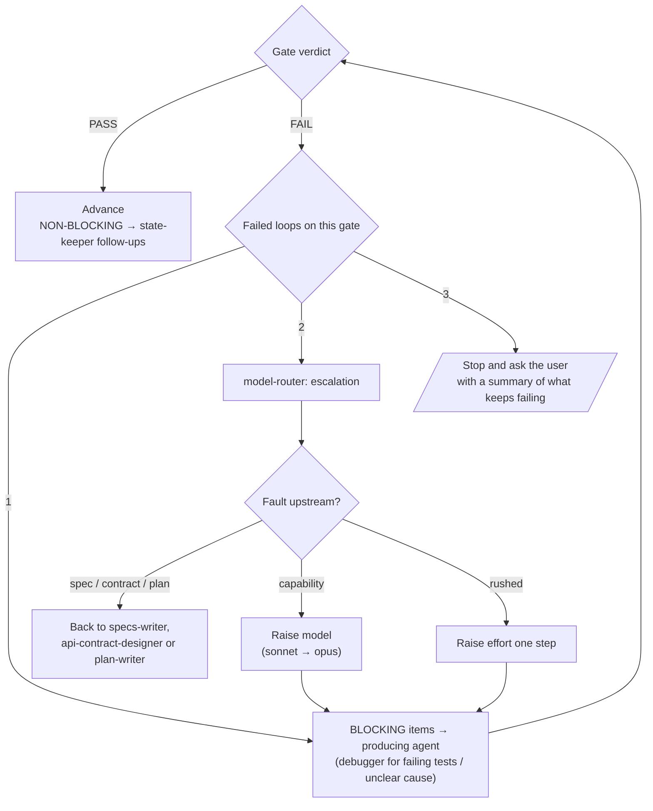

# claude-factory

Spec-driven development for [Claude Code](https://claude.com/claude-code), packaged as two
Claude Code plugins: `factory`, one orchestrator skill (`/factory`) and 30 specialised subagents,
and `factory-mods`, a hooks module that checks and measures their work. Together they take a feature from a rough idea to reviewed, tested and committed code.

Every step writes a Markdown file (requirements, spec, contracts, ADRs, plan, routing, state)
whose YAML frontmatter holds the data programs read. Every deliverable passes through a gate
agent that returns `PASS` / `FAIL`, and the orchestrator loops, escalates or asks you
instead of guessing.

- [Install](#install)
- [Usage](#usage)
- [Pipeline](#pipeline)
- [Agents map](#agents-map)
- [Agents](#agents)
- [Files](#files)
- [Data and usage](#data-and-usage)
- [Model routing](#model-routing)
- [Customising](#customising)
- [Developing the plugins](#developing-the-plugins)

## Install

At the prompt of a Claude Code session (2.1.275 or later):

```text
/plugin install factory --marketplace kazax-inc/claude-factory
/plugin install factory-mods --marketplace kazax-inc/claude-factory
```

Answer `y` to add the marketplace, then pick a scope: **user** to use the factory in every
project, **project** to share it with everyone working on the repository. From a shell:

```bash
claude plugin install factory --marketplace kazax-inc/claude-factory
claude plugin install factory-mods --marketplace kazax-inc/claude-factory
```

In the desktop app, where `/plugin` does not run: click **+** next to the prompt box, then
**Plugins**, **Add marketplace** with `kazax-inc/claude-factory`, then **Add plugin** for each of the two.

| Plugin | Brings |
|---|---|
| `factory` | the `/factory` skill and the 30 agents: the pipeline itself |
| `factory-mods` | the hooks: frontmatter checks on every write, usage stats per task, `/factory-check` |

`factory` works on its own; `factory-mods` adds the checks and the stats, and is only useful
with `factory`. Nothing else is needed: no settings to merge, no Python or Node, and the same
install works on Windows, macOS and Linux, because the hooks are a TypeScript module that
Claude Code runs itself.

Then run `/factory` in the project you want to build.

## Usage

| Command | What it does |
|---|---|
| `/factory new <feature> [idea text \| path/to/brief.md] [--until requirements\|spec\|plan\|build]` | Creates a new feature from an idea and runs the pipeline up to `--until` (default `plan`). |
| `/factory` or `/factory next [<feature>]` | Resumes the active feature (or `<feature>`) at its next step. |
| `/factory status` | Lists every feature with its phase and what it is waiting on. Read-only. |
| `/factory switch <feature>` | Makes `<feature>` the active feature. |
| `/factory-check` | Checks the frontmatter of every pipeline file and rewrites the usage stats. |

`<feature>` is a kebab-case slug. Saying "let's build X" or "spec out Y" without a command is
treated as `/factory new`; the orchestrator derives the slug and tells you. The skill is also
reachable by its plugin name, `/factory:factory`.

### Examples

```text
# Idea from a design note; stop after the plan so you can review it
/factory new usage-panel .dev/components/usage.md

# Inline idea; only write the requirements for now
/factory new oauth-login "Users sign in with GitHub instead of a password" --until requirements

# Continue it later, past the old stop point, to the end
/factory next oauth-login

# What is in flight?
/factory status
```

### Stop points (`--until`)

| Target | The run stops when… |
|---|---|
| `requirements` | `requirements.md` is written and its open questions are answered |
| `spec` | the spec passed `spec-reviewer` and you approved it |
| `plan` *(default)* | the plan passed `plan-reviewer`, every task is routed and recorded in STATE |
| `build` | every task is built, verified and committed |

At each stop you get the paths of what was produced and the command to continue.

### Greenfield vs existing codebase

During intake, `repo-explorer` maps the repo. If there is no code the feature can build on, it
reports `GREENFIELD` and the feature runs in greenfield mode:

- `architect` always runs and proposes the foundation — language and framework, project
  layout, build tool, test framework, lint/format, packaging. **You pick** before the spec is written.
- `plan-writer` opens the plan with `Phase 0 — Foundation`: project skeleton, build, lint,
  a test harness with one passing smoke test, and the commands in the README. Every feature
  task depends on it.
- `test-strategist` and `test-writer` use the test framework from the accepted ADR.

In an existing codebase the normal pipeline runs and `architect` is called only when the
feature forces structural choices.

### When you will be asked

The orchestrator stops and asks (never guesses) for:

- architectural or irreversible choices — storage, framework, public API, plugin API, data
  formats, lock-in dependencies, and the whole stack in greenfield mode;
- approval of the spec, and any spec change after approval;
- conflicting verdicts between gates;
- anything an agent lists under `QUESTIONS FOR THE USER`;
- a gate that still fails after 3 loops.

Minor choices (naming, internal structure inside a task's scope) are delegated without asking.

## Pipeline

| Phase | Agents | Exit condition |
|---|---|---|
| 0. Intake | orchestrator (`brief.md`), `repo-explorer`, `state-keeper` — `/factory new` only | brief written, mode known, feature registered |
| 1. Discover | `repo-explorer`, `researcher`*, `requirements-analyst` | requirements written, open questions answered |
| ↳ Route | `model-router` | Specify and Plan phases routed |
| 2. Specify | `architect`*, `api-contract-designer`*, `specs-writer` → `spec-reviewer` | spec-reviewer PASS, user approves spec |
| 3. Plan | `plan-writer` + `test-strategist` → `plan-reviewer` | plan-reviewer PASS |
| ↳ Route | `model-router` | every task routed |
| ↳ State | `state-keeper` | tasks recorded in STATE |
| 4. Build *(per task)* | `test-writer` ∥ `implementer`; `refactorer` / `migration-writer` by task type | code + tests written |
| 5. Verify code | `test-runner` → `code-reviewer` ∥ `security-reviewer`; `perf-reviewer`*, `dependency-auditor`* | all gates PASS |
| 6. Verify UI | `ui-reviewer`, `ux-reviewer`, `a11y-reviewer`, `e2e-tester` — UI tasks only | all gates PASS |
| 7. Close | `spec-auditor` → `docs-writer` → `commit-writer` → `state-keeper`; `retro-analyst` per plan phase | spec-auditor PASS |

\* only when relevant. `∥` = run in parallel.

### Flow

```mermaid
flowchart TD
    START(["/factory new · feature · idea"]) --> BRIEF["Write brief.md<br/>ask ≤ 3 questions if the idea is thin"]
    BRIEF --> EXPLORE["repo-explorer"]
    EXPLORE --> MODE{"GREENFIELD?"}
    MODE -- yes --> GF["mode = greenfield"]
    MODE -- no --> EX["mode = existing"]
    GF --> REG["state-keeper: register feature, make it active"]
    EX --> REG

    REG --> REQ["researcher*<br/>requirements-analyst"]
    REQ --> OQ{"Open questions?"}
    OQ -- yes --> USER1[/"User answers"/] --> REQ
    OQ -- no --> R1["model-router: route Specify + Plan"]
    R1 --> S1{{"stop if --until requirements"}}

    S1 --> ARCH{"Structural choices<br/>or greenfield?"}
    ARCH -- yes --> ADR["architect → ADRs"] --> PICK[/"User picks Proposed ADRs"/] --> CONTRACT
    ARCH -- no --> CONTRACT["api-contract-designer*"]
    CONTRACT --> SPEC["specs-writer"]
    SPEC --> SPECGATE{"spec-reviewer"}
    SPECGATE -- FAIL --> SPEC
    SPECGATE -- PASS --> APPROVE{"User approves spec?"}
    APPROVE -- changes --> SPEC
    APPROVE -- yes --> S2{{"stop if --until spec"}}

    S2 --> PLAN["plan-writer ∥ test-strategist<br/>greenfield: Phase 0 — Foundation first"]
    PLAN --> PLANGATE{"plan-reviewer"}
    PLANGATE -- FAIL --> PLAN
    PLANGATE -- PASS --> R2["model-router: route every task"]
    R2 --> ST["state-keeper: record tasks"]
    ST --> S3{{"stop if --until plan (default)"}}

    S3 --> NEXT["Next unblocked task(s)"]
    NEXT --> BUILD["test-writer ∥ implementer<br/>or refactorer / migration-writer"]
    BUILD --> VC["test-runner → code-reviewer ∥ security-reviewer<br/>+ perf-reviewer*, dependency-auditor*"]
    VC -- FAIL --> LOOP(["Gate loop ↓"])
    VC -- PASS --> UI{"ui: true?"}
    UI -- yes --> VUI["ui-reviewer, ux-reviewer,<br/>a11y-reviewer, e2e-tester"]
    VUI -- FAIL --> LOOP
    VUI -- PASS --> CLOSE
    UI -- no --> CLOSE["spec-auditor → docs-writer<br/>→ commit-writer → state-keeper"]
    CLOSE --> PHASEEND{"End of a plan phase?"}
    PHASEEND -- yes --> RETRO["retro-analyst"] --> MORE
    PHASEEND -- no --> MORE{"Tasks left?"}
    MORE -- yes --> NEXT
    MORE -- no --> DONE(["Feature done"])
```



### Gate loop

Every gate returns the same shape:

```text
VERDICT: PASS | FAIL
BLOCKING:
- [file:line] issue — why it matters — expected fix
NON-BLOCKING:
- ...
QUESTIONS FOR THE USER:
- ...
```



## Agents map

The orchestrator (the `factory` skill) is the only one that talks to you and the only one that
spawns agents (as `factory:<agent>`). Agents never see the conversation: each gets a
self-contained brief with the feature, mode, task, file scope and paths to the spec, plan and
state.

```mermaid
flowchart LR
    USER(("You")) <--> ORCH["factory skill<br/>(orchestrator)"]

    subgraph DISCOVER["Discover"]
        repo_explorer["repo-explorer"]
        researcher
        requirements_analyst["requirements-analyst"]
    end

    subgraph SPECIFY["Specify"]
        architect
        api_contract_designer["api-contract-designer"]
        specs_writer["specs-writer"]
    end

    subgraph PLANNING["Plan"]
        plan_writer["plan-writer"]
        test_strategist["test-strategist"]
    end

    subgraph BUILDING["Build"]
        implementer
        test_writer["test-writer"]
        refactorer
        migration_writer["migration-writer"]
        debugger
    end

    subgraph GATES["Gates — PASS / FAIL"]
        spec_reviewer["spec-reviewer"]
        plan_reviewer["plan-reviewer"]
        test_runner["test-runner"]
        code_reviewer["code-reviewer"]
        security_reviewer["security-reviewer"]
        perf_reviewer["perf-reviewer"]
        dependency_auditor["dependency-auditor"]
        ui_reviewer["ui-reviewer"]
        ux_reviewer["ux-reviewer"]
        a11y_reviewer["a11y-reviewer"]
        spec_auditor["spec-auditor"]
    end

    subgraph CLOSING["Close"]
        e2e_tester["e2e-tester"]
        docs_writer["docs-writer"]
        commit_writer["commit-writer"]
        retro_analyst["retro-analyst"]
    end

    subgraph SUPPORT["Cross-cutting"]
        model_router["model-router"]
        state_keeper["state-keeper"]
    end

    ORCH --> DISCOVER
    ORCH --> SPECIFY
    ORCH --> PLANNING
    ORCH --> BUILDING
    ORCH --> GATES
    ORCH --> CLOSING
    ORCH --> SUPPORT

    specs_writer -. reviewed by .-> spec_reviewer
    plan_writer -. reviewed by .-> plan_reviewer
    test_strategist -. reviewed by .-> plan_reviewer
    implementer -. verified by .-> test_runner
    test_runner -. failures .-> debugger
    implementer -. audited by .-> spec_auditor
    model_router -. routing.md .-> ORCH
    state_keeper -. STATE.md .-> ORCH
    retro_analyst -. proposals .-> ORCH
```

## Agents

Default model / effort are each agent's own; `model-router` can raise them per task.

### Discover

| Agent | Default | Role |
|---|---|---|
| `repo-explorer` | haiku / medium | Read-only codebase mapper. Returns relevant files, symbols, conventions and reuse/collision risks — or `GREENFIELD` when there is nothing to build on. |
| `researcher` | sonnet / medium | External research on libraries, APIs, packages, standards and prior art, with current, sourced facts. |
| `requirements-analyst` | opus / medium | Turns the brief into `requirements.md`: user stories, Given/When/Then acceptance criteria, edge cases, non-goals, open questions. |

### Specify

| Agent | Default | Role |
|---|---|---|
| `architect` | opus / high | Proposes architecture options with trade-offs and records them as ADRs. Decides minor matters, never irreversible ones; always decides the foundation in greenfield mode. |
| `api-contract-designer` | opus / medium | Defines the interfaces a feature introduces or changes (module APIs, plugin API, IPC, events, schemas) so implementation can proceed in parallel against a fixed contract. |
| `specs-writer` | opus / high | Writes `spec.md`, the authoritative description of behavior that plans, code, tests and reviews are checked against. |

### Plan

| Agent | Default | Role |
|---|---|---|
| `plan-writer` | opus / high | Breaks the approved spec into phased, ordered tasks with dependencies, file scopes, task types and done criteria. |
| `test-strategist` | sonnet / medium | Maps every SPEC item and acceptance criterion to the tests that will prove it and lists needed fixtures and infrastructure. |

### Build

| Agent | Default | Role |
|---|---|---|
| `implementer` | sonnet / medium | Implements exactly one plan task inside its file scope and makes its tests pass; also applies BLOCKING fixes from gates. |
| `test-writer` | sonnet / medium | Writes a task's tests from the spec and test strategy — never from the implementation. |
| `refactorer` | sonnet / medium | Behavior-preserving restructuring for tasks of type `refactor`. |
| `migration-writer` | opus / medium | Data, schema, file-format or settings migrations with forward and rollback paths, for tasks of type `migration`. |
| `debugger` | opus / high | Root-causes failing tests, build errors, crashes or a gate failure the implementer could not fix, and applies the minimal fix. |

### Gates

| Agent | Default | Reviews |
|---|---|---|
| `spec-reviewer` | opus / medium | The spec: ambiguity, contradictions, untestable statements, missing edge cases, gaps against requirements. |
| `plan-reviewer` | opus / medium | The plan: spec coverage, task size, ordering, parallel-scope conflicts, missing infrastructure, rollback gaps. |
| `test-runner` | haiku / low | Build, formatter, linter, type checks and tests; returns a short failure digest. |
| `code-reviewer` | opus / medium | The diff: correctness, conformance to spec and contracts, conventions, error handling, test quality, dead code. |
| `security-reviewer` | opus / high | The diff: injection, path traversal, unsafe deserialization, permissions, IPC exposure, secrets, unsafe code, risky deps. |
| `perf-reviewer` | sonnet / medium | Hot paths: complexity, allocations, redundant work, rendering cost, blocking I/O, chatty IPC. Only when performance matters. |
| `dependency-auditor` | sonnet / medium | Added/upgraded dependencies: license, maintenance, advisories, size, duplication. Whenever a manifest or lockfile changes. |
| `ui-reviewer` | sonnet / medium | Visual implementation vs spec and design system, all UI states, themes, responsiveness (uses screenshots). UI tasks only. |
| `ux-reviewer` | opus / medium | Interaction design: flows, affordances, feedback, error recovery, undo, keyboard/pointer ergonomics. UI tasks only. |
| `a11y-reviewer` | sonnet / medium | Accessibility: contrast, keyboard, focus, ARIA, reduced motion, text scaling. UI tasks only. |
| `spec-auditor` | opus / medium | Drift in both directions between spec and code/tests, when closing a task batch or plan phase. |

### Close

| Agent | Default | Role |
|---|---|---|
| `e2e-tester` | sonnet / medium | Runs the spec's acceptance criteria end-to-end through the real UI; after UI tasks and at the end of a plan phase. |
| `docs-writer` | sonnet / medium | Updates README, API/plugin docs, doc comments and spec status to match what was built. |
| `commit-writer` | haiku / low | Commits a finished task with a Conventional Commits message referencing task and spec ids; drafts PR descriptions and changelog entries. |
| `retro-analyst` | sonnet / medium | End-of-phase retrospective: what looped, which gates failed and why; proposes edits to agent prompts, templates and rules. |

### Cross-cutting

| Agent | Default | Role |
|---|---|---|
| `model-router` | opus / high | Assigns model and effort to every agent call, optimizing total cost to an accepted result; handles escalations after repeated gate failures. |
| `state-keeper` | haiku / low | The only writer of `.plan/STATE.md` (feature index) and `.plan/<feature>/STATE.md`, and records decisions on ADRs. Mechanical bookkeeping only. |

## Files

| Path | Written by |
|---|---|
| `.specs/<feature>/brief.md` | orchestrator — your idea verbatim + intake answers |
| `.specs/<feature>/requirements.md` | `requirements-analyst` |
| `.specs/<feature>/spec.md` | `specs-writer` |
| `.specs/<feature>/contracts.md` | `api-contract-designer` |
| `.specs/<feature>/adr/NNNN-<slug>.md` | `architect`; `state-keeper` records the decision |
| `.plan/<feature>/plan.md` | `plan-writer` |
| `.plan/<feature>/test-strategy.md` | `test-strategist` |
| `.plan/<feature>/routing.md` | `model-router` |
| `.plan/<feature>/retro-<phase>.md` | `retro-analyst` |
| `.plan/<feature>/STATE.md` | `state-keeper` — tasks, verdicts, decisions, blockers, follow-ups, next step |
| `.plan/STATE.md` | `state-keeper` — index of all features and the active one |
| `.plan/<feature>/stats/{runs,tasks,orchestrator}/*.md` | `factory-mods` hooks — usage per subagent run, per task, and for the orchestrator |

Every file has a YAML frontmatter with its data (task statuses, gate verdicts, routing,
decisions, SPEC and AC ids, open questions, ADR options…); the formats are in
[`docs/data.md`](plugins/factory-mods/docs/data.md).

## Data and usage

The data lives where the agents write it: in the YAML frontmatter of each Markdown file, the
way Claude Code's own skills and agents carry theirs. There is no second, derived copy to
drift from it.

- **Checked on write.** After every Write or Edit of a `.plan/` or `.specs/` file, the
  `factory-mods` hooks check its frontmatter (fields, allowed values, task ids that match plan.md,
  ADR ids that match their file…) and hand any error back to the agent that wrote it, which
  fixes the file in the same run.
- **Usage stats.** The hooks sum the model requests Claude Code reports for every subagent
  run: time, exact tokens (input, output, cache read, cache write), cache hit rate and peak
  context. The orchestrator opens each brief with `Feature` / `Phase` / `Task`, so runs roll
  up to task, phase and plan in `.plan/<feature>/stats/`, as Markdown files whose frontmatter
  holds the numbers. A task's file also stamps when it started and finished.
- **Progress** (counts, percent, ready tasks, phase and stage status) is computed by readers
  from STATE.md and plan.md, with the rules in [`docs/data.md`](plugins/factory-mods/docs/data.md).

`/factory-check` checks every pipeline file at once and rewrites the task stats from the run
files.

## Model routing

The orchestrator never picks models itself. `model-router` writes `routing.md`, optimizing the
**total cost to an accepted result**, not price per token: a cheap model that loops through
gates costs more than a strong one that gets it right first time.

- **opus** — anything that needs judgement or design; high/xhigh effort for hard reasoning
  (algorithms, concurrency, security, migrations with data-loss risk).
- **sonnet** — well-specified, local work that follows an existing pattern and has fast tests.
- **haiku** — mechanical work with deterministic verification (running commands, bookkeeping,
  commits, read-only search).
- Gates are never routed below their default. Escalation raises the model for capability
  failures and the effort for rushed work.

## Customising

Fork this repository, edit it, and install your fork the same way
(`/plugin install factory --marketplace <you>/claude-factory`, and the same for `factory-mods`).

- **Agents** — each agent is a single Markdown file in `plugins/factory/agents/` with its default `model`,
  `effort` and `tools` in the frontmatter.
- **Pipeline rules** — phases, gate loop limits and escalation rules live in
  `plugins/factory/skills/factory/SKILL.md`. `retro-analyst` proposes edits to these; it never applies them.
- **Formats** — a frontmatter field is defined in three places that must agree: the template
  in the agent that writes it, the schema in
  `plugins/factory-mods/hooks/schemas.ts`, and `plugins/factory-mods/docs/data.md`.

## Developing the plugins

```text
.claude-plugin/marketplace.json            makes this repository a marketplace of both plugins
plugins/factory/
  .claude-plugin/plugin.json               the factory manifest
  skills/factory/SKILL.md                  the orchestrator
  agents/*.md                              the 30 subagents
plugins/factory-mods/
  .claude-plugin/plugin.json               the factory-mods manifest
  hooks/hooks.json                         names the hooks module
  hooks/register.ts                        the hooks: frontmatter checks, usage stats, /factory-check
  hooks/schemas.ts, yaml.ts                the frontmatter schemas and the YAML subset parser
  hooks/stats.ts                           usage metrics
  hooks/factory.test.ts                    tests
  docs/data.md                             the data formats
```

Run a session with your working copy loaded, check it, and run the tests:

```bash
claude --plugin-dir plugins                   # a session with both plugins loaded from this folder
claude plugin validate .                      # the marketplace
claude plugin validate plugins/factory        # the factory manifest
claude plugin validate plugins/factory-mods   # the factory-mods manifest and hooks module
claude plugin test plugins/factory-mods       # hooks/*.test.ts
```

The hooks module runs in Claude Code's own environment (no Node, no DOM): it reaches files,
the clock and the session only through Claude Code's `$` interface.

## License

[MIT](LICENSE)
